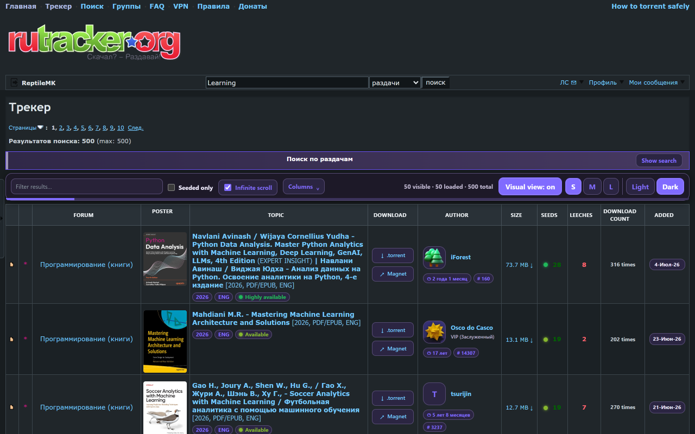

<div align="center">


<h1>RuTracker Visual Enhancer</h1>

<p><strong>Posters, instant filters, infinite scrolling and a polished Light or Dark theme for RuTracker search results.</strong></p>

[](https://chromewebstore.google.com/detail/rutracker-visual-enhancer/nlbflmfklikjpiloaoobnonplpidmfgc)
[](https://vitaliesdev.github.io/rutracker-visual-enhancer/)
[](#features)
[](https://ko-fi.com/vitalies)

[Install](#install) · [Features](#features) · [Build it yourself](#build-it-yourself) · [Support](#support-the-project)



</div>

## About

A free, unofficial browser extension for Chrome and Brave that turns RuTracker's plain result table into something you can scan at a glance. Every result gets its poster and a short summary, a toolbar lets you filter what is already loaded, and the next pages can load on their own as you scroll.

It works on top of the original site rather than replacing it: the links, the `.torrent` files and the Magnet links are RuTracker's own, and **Escape** or the floating toggle brings back the original table at any time.

## Why use it

- **Find releases faster.** Posters, summaries and tags (year, resolution, source, codec, language) tell you what a release is before you open it.
- **Fewer clicks.** Download the `.torrent` or open the Magnet link straight from the results; see the author and the upload date at a glance.
- **Filter instantly.** Narrow the loaded results by text or to seeded releases only, without sending a new search.
- **Keep scrolling.** Optional infinite scrolling loads one page at a time, and going back from a topic returns you to the same spot.
- **Easy on the eyes.** A full-site Dark theme for result, forum and topic pages, applied before the page paints, so there is no white flash.
- **Light and private.** No framework, no analytics, no ads and no remote code. Topic details are fetched only from the site you are on, cached locally for 7 days, and nothing is sent to the developer.
- **Reversible.** Simple view restores the site exactly as it was.

## Features

- Posters in three sizes, with a larger preview on hover, loaded only near the visible area
- Short topic summaries directly in the results
- `.torrent` and Magnet actions next to each result
- Author cards (avatar, rank, membership, messages) and clearer upload dates
- Text and "Seeded only" filters, with live visible / loaded / total counters
- Columns menu to show or hide any column; the site's own column sorting keeps working
- Optional infinite scrolling with page dividers, retry on errors and position restore
- Collapsible advanced search form
- Full-site Light and Dark themes, with readable contrast on every page
- Interface in English, Ukrainian, Russian, Romanian and Spanish
- Posters on other trackers built on the same forum engine, enabled per site from the extension icon

The complete list is in [FEATURES.md](FEATURES.md).

## Install

- **Chrome Web Store:** [install it here](https://chromewebstore.google.com/detail/rutracker-visual-enhancer/nlbflmfklikjpiloaoobnonplpidmfgc). It also works in Brave and other Chromium-based browsers.
- **From source:** open `chrome://extensions` (or `brave://extensions`), turn on **Developer mode**, choose **Load unpacked** and select the `extension` folder.

On another tracker built on the same forum engine, click the extension icon and choose **Show posters on…**. The browser asks for access to that one site only, and the same button turns it off again. These sites get posters only, shown inside the title cell, so their layout and sorting stay untouched.

## Build it yourself

The Chrome Web Store package is the `extension` folder zipped, so you can build exactly the same file from this source.

<details>
<summary>Requirements and build steps</summary>

### Requirements
- [Node.js](https://nodejs.org/) 18 or newer (the packaging script has no dependencies; ESLint is installed by `npm install`)
- Windows for `release.cmd`; the npm scripts work on any system

### Build
On Windows, double-click **`release.cmd`**: it installs the dependencies the first time, lints the code, bumps the patch version and writes the zip to `dist\`.

Or from a terminal:
```bash
npm install
npm run lint
npm run bump -- patch    # or minor, major, or an explicit X.Y.Z
npm run build            # dist/rutracker-visual-enhancer-v<version>.zip
```

`npm run build` zips the **contents** of `extension/` with forward-slash paths, as the Chrome Web Store expects. Everything it produces goes to `dist/`, which is not part of the repository.

</details>

## Project layout

| Path | What |
|---|---|
| `extension/` | The extension (Manifest V3): page scripts and styles, popup, service worker, icons and translations |
| `docs/` | The website, published with GitHub Pages from `main` → `/docs` (home, privacy policy, help) |
| `store/` | Chrome Web Store material: listing texts, screenshots, promotional images, privacy and review notes, and a validator for the kit |
| `scripts/` | `build.mjs` packages the extension; `bump.mjs` updates the version |
| `release.cmd` | One double-click to lint, bump the version and build |

<details>
<summary>Inside <code>extension/</code></summary>

| File | What |
|---|---|
| `content.js`, `content.css` | Everything on the page: posters, toolbar, filters, infinite scrolling and the themes |
| `theme-bootstrap.js` | Applies the saved theme at `document_start`, before the first paint |
| `options.html`, `options.js`, `options.css` | The popup: interface language and per-site access |
| `support.js` | Shared popup links and icons |
| `background.js` | Small event-driven service worker for the toolbar icon badge |
| `runtime-i18n.js`, `_locales/` | Interface texts, and the store name and description, in five languages |
| `icons/` | Extension icons from 16 to 128 px |

RuTracker gets the full interface. Other trackers the user enables run in a posters-only mode, injected only after the user grants access to that site.

</details>

## Privacy

Preferences and a small cache of topic details (up to 300 entries, kept 7 days) stay in your browser's extension storage. Topic pages are requested only from the site you are on, using your existing session. See the full [privacy policy](https://vitaliesdev.github.io/rutracker-visual-enhancer/privacy.html).

## Support the project

This extension is free and made in my spare time. If it saved you time or you simply enjoy it, you can help me keep making tools like this.

[](https://ko-fi.com/vitalies)

## Credits

- **RuTracker Visual Enhancer:** REPTIX · Vitalie
- This is an independent, unofficial extension, not affiliated with or endorsed by RuTracker. Use it in line with the site's rules and the law where you live.
- Chrome is a trademark of Google LLC. Brave is a trademark of Brave Software, Inc.

<div align="center">

[GitHub](https://github.com/vitaliesdev) · [Website](https://vitaliesdev.github.io/rutracker-visual-enhancer/) · [Ko-fi](https://ko-fi.com/vitalies)

Made by REPTIX · Vitalie

</div>
